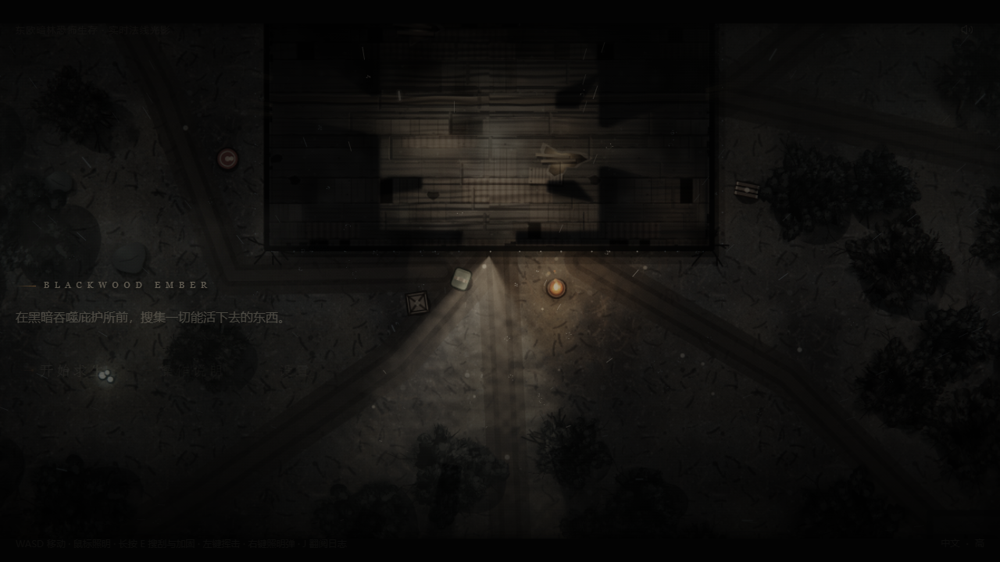
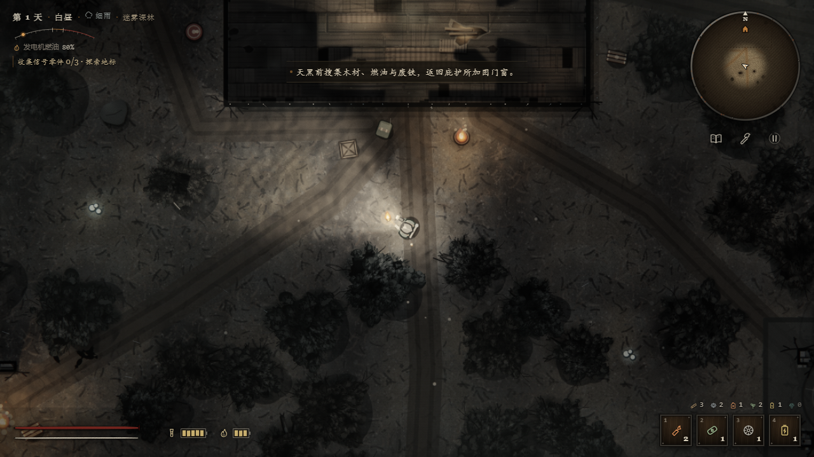
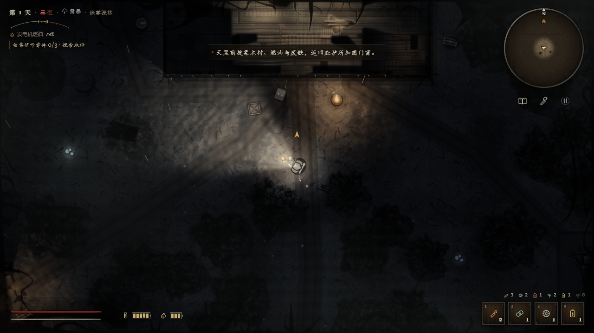
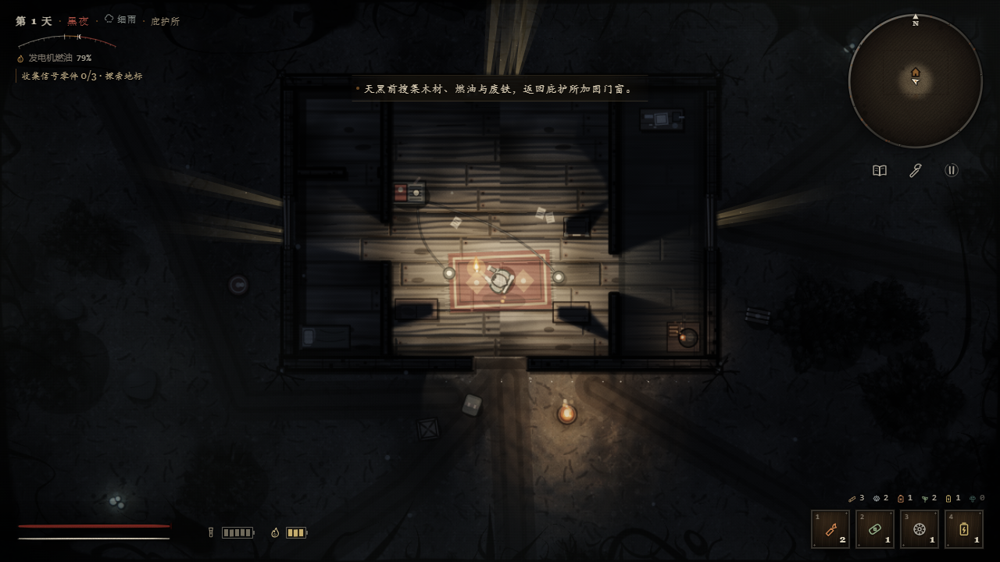

# Blackwood Ember (`Darkwood_Web`)

**A 369 KB pure-browser WebGL2 top-down survival horror engine inspired by *Darkwood* — zero game engine, zero external CDN assets, full 2D raycast visibility cone, deferred normal-mapped lighting, procedural audio, and automated visual/physics QA gates.**

[English](./README.md) | [简体中文](./README_CN.md) | [Architecture Deep Dive](./docs/ARCHITECTURE.md) | [Design Invariants](./DESIGN_INVARIANTS.md)


-orange)


---

## Screenshots (Real-Time WebGL2 Capture)

| Title Screen (Live Rainy Forest) | Daytime Forest Exploration |
| :---: | :---: |
|  |  |
| **Night Flashlight & Visibility Cone** | **Hideout Generator & Door-Crack Light Shafts** |
|  |  |

---

## Why This Repo Is Interesting (Engineering Highlights)

Most browser game demos rely on Unity WebGL (30–80 MB WASM payloads) or heavy frameworks. **Blackwood Ember** is an experiment in pushing pure TypeScript + custom WebGL2 + AI-assisted engineering with strict automated quality gates:

1. **Darkwood-Style Dual Visibility Law (`src/game/visibility.ts`)**
   - Inside the flashlight/vision cone: full normal-mapped lighting, wet puddle speculars, and active enemies.
   - Outside the cone: decays into low-contrast cold-gray memory fog; **enemies are hidden in the dark** and only reveal briefly via lightning strikes, bear traps, or acoustic ripples / door impacts.
2. **Custom WebGL2 Deferred Normal-Mapped Lighting (`src/game/webglComposer.ts` + `renderer.ts`)**
   - Multi-layered procedural foliage with top-down height parallax and wind wave phase offsets.
   - Volumetric door/window crack light shafts, ACES Filmic tone mapping, dynamic rain ripples, and campfire ember physics—with automatic Canvas2D fallback.
   - **156 draw calls/frame** (budget ≤ 180) and **p95 simulation time of 0.112 ms** across a 7,200-frame headless stress test.
3. **Tactile Top-Down Combat & Barricading (`src/game/engine.ts`)**
   - Fixed-timestep simulation (`FIXED_DT = 1/60`), 3-stage charged melee swings with `hitStop`, stamina-gated dodge roll with `0.18s` i-frames, and **draggable furniture** (`E`) to barricade broken doors/windows against night intruders.
4. **369 KB Offline Single-Package Build (`npm run build:minitool`)**
   - Zero external fonts, zero external CDN requests, zero `404`s, procedural Web Audio foley (`src/game/audio.ts`).
5. **Automated "Art Director + QA" Verification Gates (`tools/checks/`)**
   - Instead of eyeballing AI-generated code changes, every build is verified by headless Playwright & simulation probes:
     - `check:sim` — 7,200-frame headless physics, collision, combat & full-run stress test
     - `check:palette` — automated luminance (`L`), dark-ratio, and color-chroma art-direction assertions
     - `check:perf` — 1x & 2x CPU-throttled frame-time & draw-call budget gate
     - `check:shotdiff` — deterministic pixel regression & A/B visual variant diffing (`?v-palette=a|b`, `?v-cine=a|b`, etc.)

---

## Quick Start

```bash
# 1. Install dependencies
npm install

# 2. Run local dev server (http://localhost:3000)
npm run dev

# 3. Build standalone offline HTML / 369 KB offline minitool zip
npm run build:single
npm run build:minitool
```

### Run the Automated QA & Art-Direction Gates

```bash
# Tier 1: TypeScript + 7200-frame physics sim + smoke + layout + modal stack
npm run check:t1

# Tier 2: Art-direction palette metrics, CPU perf budget & pixel shotdiff
npm run check:palette
npm run check:perf
npm run check:shotdiff
```

### Controls

| Input | Action |
| :--- | :--- |
| `W A S D` | Move |
| `Mouse` | Aim vision cone / flashlight |
| `Left Click` (Tap / Hold) | Quick slash / Charged heavy swing |
| `Space` | Dodge roll (i-frames) |
| `E` | Interact / Grab & drag furniture to barricade doors |
| `F` | Toggle flashlight / torch |
| `Tab` / `C` / `J` | Map / Crafting / Journal |

> **Tip for graphics/engine nerds**: Append `?dev` and A/B switches like `?v-shader=a` (Canvas2D fallback) vs `b` (WebGL2), `?v-vision=a|b`, or `?v-cine=a|b` to inspect rendering passes live. See [DESIGN_INVARIANTS.md](./DESIGN_INVARIANTS.md).

---

## Architecture Overview

See [docs/ARCHITECTURE.md](./docs/ARCHITECTURE.md) for the full Single-Source-of-Truth module map, rendering pipeline, and how we built automated Playwright visual/physics regression gates for AI-assisted game development.

---

## Disclaimer & License

- **Fan-made Technical Tribute**: *Blackwood Ember* is an independent, non-commercial open-source technical study inspired by the atmosphere and visibility mechanics of Acid Wizard Studio's *Darkwood*. All code, procedural textures, shaders, and synthesized audio in this repository are original implementations. Please support the original *Darkwood* on Steam!
- Licensed under the [MIT License](./LICENSE).
