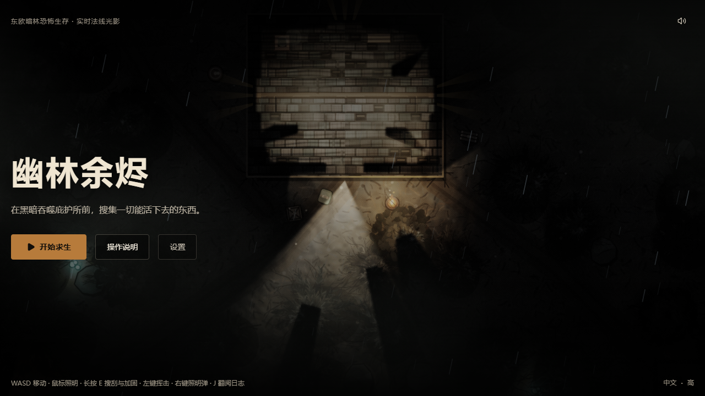
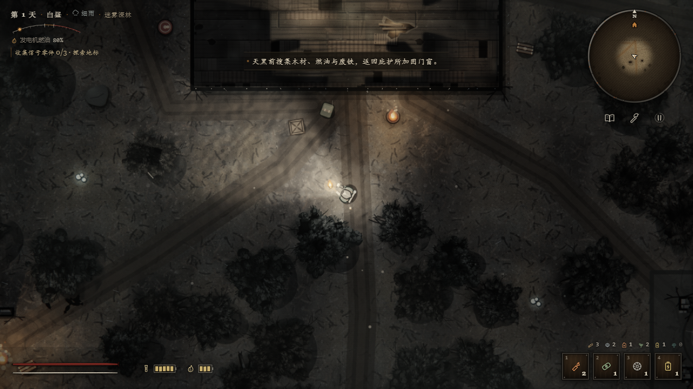
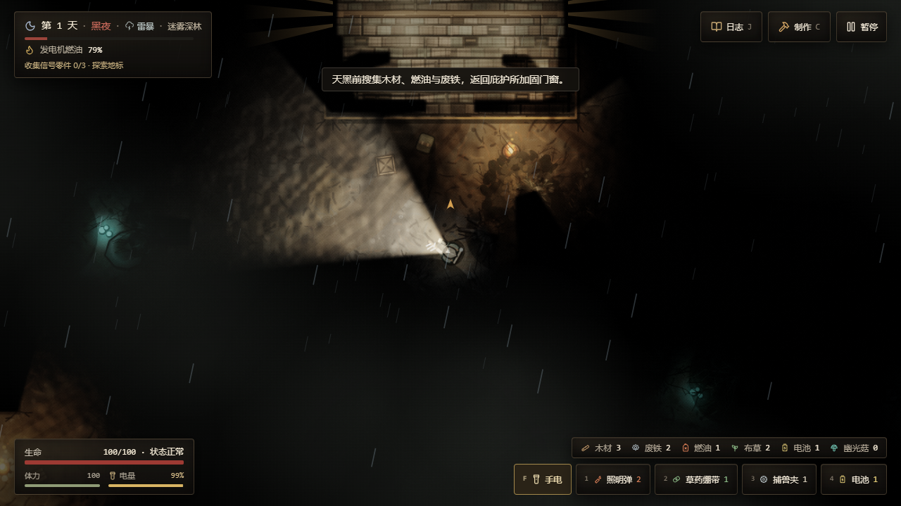
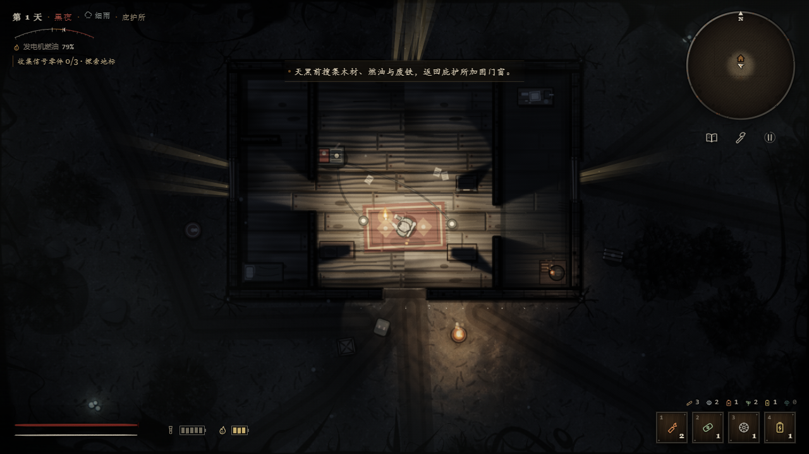

# 幽林余烬 · Blackwood Ember (`Darkwood_Web`)

**致敬《阴暗森林 Darkwood》的纯浏览器 WebGL2 俯视角生存恐怖引擎：零游戏引擎依赖、零外链资源、最终离线包仅 369 KB，完整实现 2D 视野锥射线阴影、WebGL2 延迟法线光影、拖拽家具堵门与全套自动化视觉/物理验收门禁。**

[English](./README.md) | [简体中文](./README_CN.md) | [架构深度解析](./docs/ARCHITECTURE.md) | [工程与美术红线](./DESIGN_INVARIANTS.md)

---

## 实机截图（WebGL2 实时渲染）

| 实时雨夜标题页 | 白昼林地探索 |
| :---: | :---: |
|  |  |
| **黑夜手电与视野锥迷雾** | **庇护所发电机与门窗缝隙漏光** |
|  |  |

---

## 核心技术亮点

相比动辄 30–80 MB 的 Unity WebGL 导出包，本项目探索了**纯 TypeScript + 手写 WebGL2 + AI 辅助工程化验收门禁**的极限落地：

1. **Darkwood 灵魂机制：视野锥内外双重法则（`src/game/visibility.ts`）**
   - 视野锥内：完整法线凹凸光影、雨地积水高光与实体可见。
   - 视野锥外：退化为低对比冷灰记忆迷雾；**敌人藏匿于黑暗中不可见**，仅在闪电劈照、踩中捕兽夹或撞击门板产生声波涟漪时短暂暴露。
2. **手写 WebGL2 延迟法线光影与电影级后期（`src/game/webglComposer.ts`）**
   - 门窗破损缝隙透出锐利条状体积光、顶视高度视差多层树冠随风摇曳、ACES Filmic 色调映射、雨丝水花与篝火余烬物理，并自带 Canvas2D 无缝回退。
   - 正常帧 **156 drawCalls**（预算 ≤ 180），7,200 帧无头物理压测 **p95 仅 0.112 ms**。
3. **硬核俯视角动作与庇护所防御（`src/game/engine.ts`）**
   - 固定步长 `FIXED_DT = 1/60`、三段蓄力重击 + `0.055s` 顿帧 `hitStop`、带 `0.18s` 无敌帧的闪避急退，以及**按 `E` 拖拽沙发/木柜堵住破损门窗**。
4. **极致轻量化：369 KB 纯离线单包（`npm run build:minitool`）**
   - 零外部 CDN、零字体外链、纯程序化 Web Audio 分层拟音（`src/game/audio.ts`），打开即玩。
5. **AI 时代稀缺的“自动化主美 + QA 门禁体系”（`tools/checks/`）**
   - 不靠肉眼盲测 AI 改的代码，用脚本把主观视觉与手感固化为 CI 级硬指标：
     - `check:sim`：7,200 帧无头物理/碰撞/防穿墙/通关全链路压测
     - `check:palette`：自动校验 4 个标准机位的平均亮度 `L`、暗部占比与色彩丰度
     - `check:perf`：1x / 2x CPU 降速帧耗时与 drawCalls 预算门禁
     - `check:shotdiff`：A/B 渲染开关（`?v-palette=a|b`、`?v-cine=a|b`）像素级回归比对

---

## 快速运行

```bash
# 1. 安装依赖
npm install

# 2. 启动本地开发服 (http://localhost:3000)
npm run dev

# 3. 打包单文件离线 HTML / 369 KB 离线小工具包
npm run build:single
npm run build:minitool

# 4. 运行自动化物理与视觉验收门禁
npm run check:t1
npm run check:palette
npm run check:perf
```

---

## 免责声明与协议

- 本项目为致敬 Acid Wizard Studio《Darkwood（阴暗森林）》氛围与视野机制的**非商业开源技术实验**，所有代码、程序化纹理、Shader 与合成音效均为独立原创实现。请支持 Steam 原版神作《Darkwood》！
- 采用 [MIT License](./LICENSE) 开源。
